<div align="center">


# Immifile

**Your case. More clarity.**

An iOS app that helps immigrants keep track of their USCIS cases, find official help,<br/>
and figure out which form they need, without pretending to be a lawyer.


<br/>

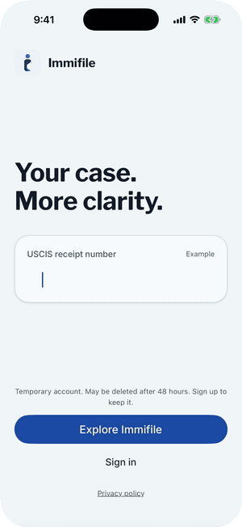&nbsp;
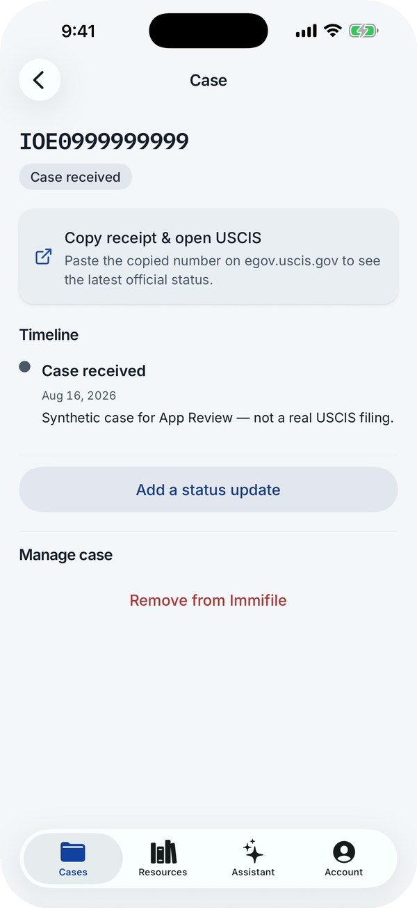&nbsp;
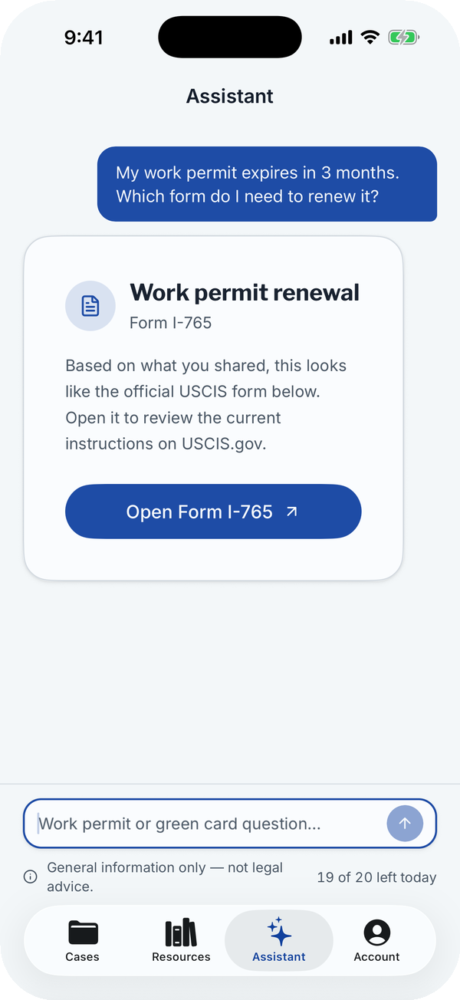&nbsp;
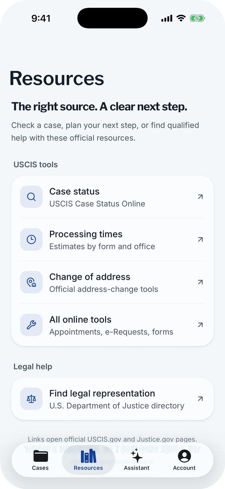

</div>

<br/>

## About the app

Immigration paperwork comes with receipt numbers, renewal deadlines and official pages written for lawyers. Immifile puts it all in one calm place.

- **Track every case.** Save the receipt number from your USCIS notice and keep a timeline of every update you get. One tap copies the number and opens the official USCIS status page.
- **Find the right form.** Describe your situation in your own words. The assistant points you to exactly one official form, Form I-765 (work permit) or Form I-90 (green card), and links straight to it on USCIS.gov.
- **Official help, one tap away.** Case status, processing times, change of address, and a directory of qualified legal help, all straight from USCIS.gov and Justice.gov.
- **Private by design.** The assistant asks for consent before anything leaves your phone and never stores your conversation. Start as a guest, create an account (email, Apple or Google) to keep your data, and delete everything from inside the app at any time.
- **Built for everyone.** Light and dark mode, Dynamic Type up to the largest accessibility sizes, and VoiceOver support.

**Status:** version 1.0 is in TestFlight beta. App Store submission is next.

## Why I built this

I'm an immigrant myself, so this paperwork is part of my life. A single receipt notice can decide whether you can keep working. A missed renewal date can cost months, and the official answers are spread across government pages that assume you already know the system.

Too often, the first answer people get comes from a group chat or from someone charging money to tell them which form to file. I wanted a free, honest tool that does three things well: keeps your case in one place, sends you to the official source, and gives a clear answer to "which form do I need?" without crossing into legal advice.

## See it in action

<div align="center">

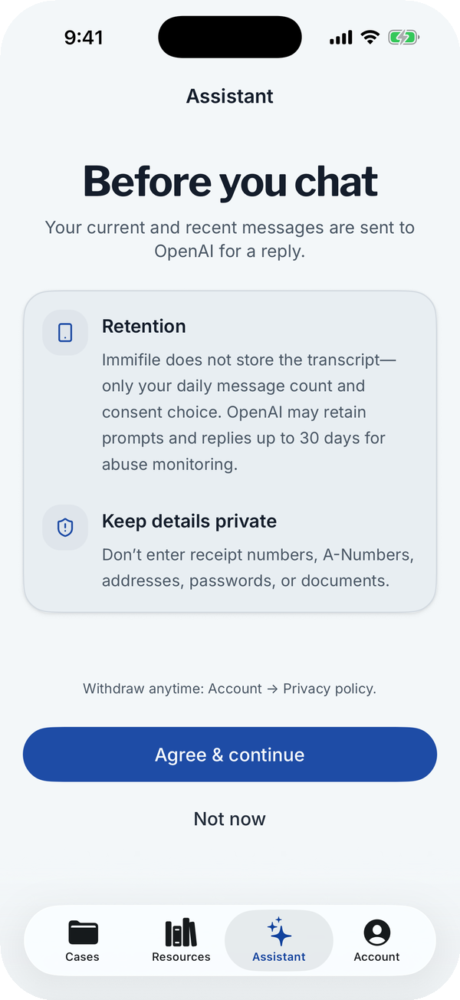&nbsp;
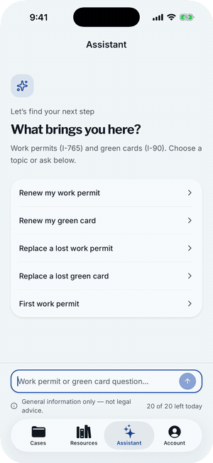

<sub>Consent comes first → ask in plain words → get one clear, official answer</sub>

<br/><br/>

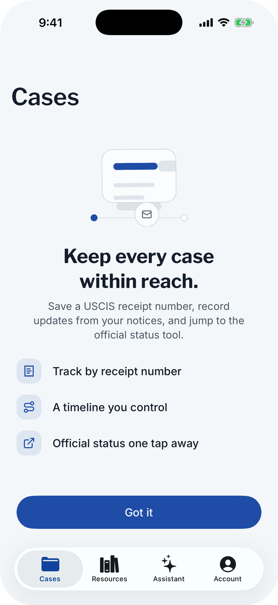&nbsp;
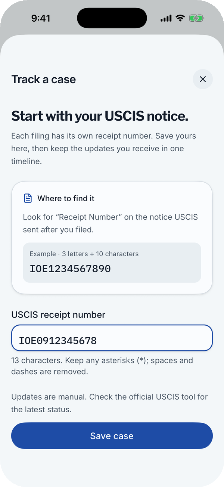&nbsp;
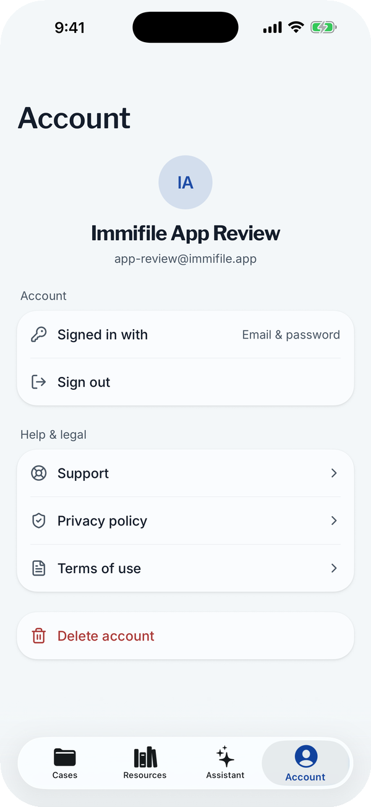

<sub>Track a case → add your receipt number → stay in control of your account</sub>

<br/><br/>

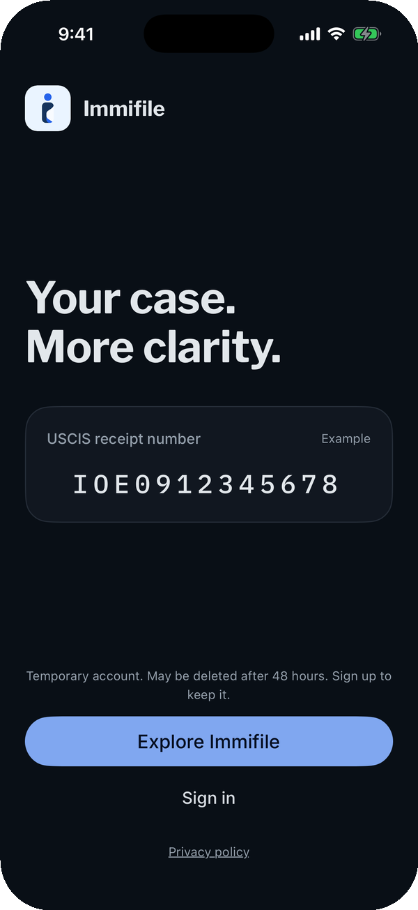&nbsp;
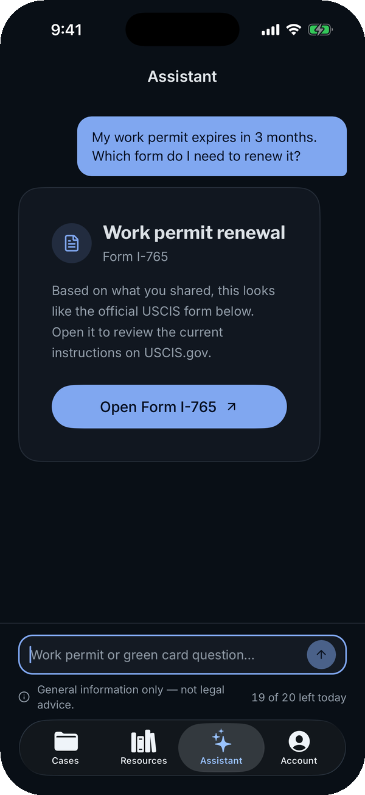

<sub>Full dark mode</sub>

</div>

## How it's built

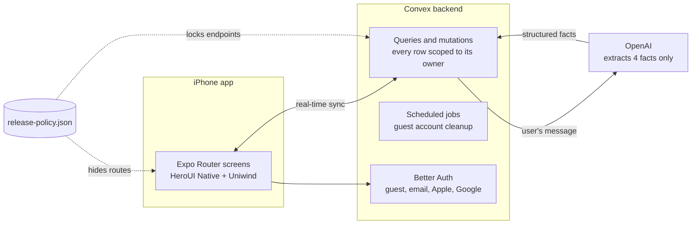

| Layer | Tools |
| --- | --- |
| App | Expo SDK 57, React Native 0.86, React 19, TypeScript, Expo Router |
| UI | HeroUI Native, Uniwind (Tailwind CSS v4), Reanimated, custom "Security Ink" design tokens |
| Forms | TanStack Form |
| Backend | Convex: database, real-time queries, file storage, scheduled jobs |
| Auth | Better Auth: guest accounts, email and password, Sign in with Apple, Google |
| AI | OpenAI behind a server-side fact extractor, with a 36-case evaluation suite |
| Testing | Vitest, convex-test, Maestro UI flows |
| Shipping | EAS Build and Submit, TestFlight, GitHub Actions |

## Challenges and how I solved them

<details>
<summary><b>Keeping an AI assistant from giving legal advice</b></summary>
<br/>

**Problem.** People describe their situation in their own words. A normal chatbot can drift into legal advice, which could hurt users and is risky for the app.

**What I did.** The model never writes to the user. It only extracts four plain facts from the message: which document, which situation, whether the user wants a legal judgment, and whether it's a topic the app doesn't cover. Ordinary code then picks the form and writes every word on screen. Questions about eligibility, approval odds or topics like asylum get a fixed, safe reply instead, which points to a qualified immigration attorney or accredited representative when needed.

**Proof.** A 36-case evaluation suite ([`scripts/eval-navigator.ts`](scripts/eval-navigator.ts)) reruns each case against the live model to catch drift. The 20-message daily limit is enforced on the server, and transcripts are never stored. Design record: [ADR-0015](docs/internal/adr/0015-safe-navigator-facts-not-decisions.md).

</details>

<details>
<summary><b>A hidden screen isn't a locked door</b></summary>
<br/>

**Problem.** For the first App Store release I switched off features that weren't ready for review. But hiding a tab isn't security: every backend function is a public endpoint, and a guest session is free to create. The hidden features' endpoints were still reachable.

**What I did.** One source-controlled file, [`release-policy.json`](release-policy.json), drives both sides. The app refuses any route it doesn't explicitly allow, so a new screen can't slip into the release by accident. On the server, 48 gate checks run as the first line of each gated handler, before any user data is touched.

**Proof.** [`convex/releaseGate.test.ts`](convex/releaseGate.test.ts) reads the real policy and fails if any hidden endpoint becomes reachable again.

</details>

<details>
<summary><b>Letting people try the app without signing up, and cleaning up safely</b></summary>
<br/>

**Problem.** Asking for an account up front scares people away, so the app starts with a guest account. Abandoned guests have to be deleted, but a guest might create a real account at the exact moment cleanup runs.

**What I did.** An hourly job deletes guest accounts older than 48 hours. It re-checks each account right before deleting it, and removes app data before login records so a failed run can safely retry. Convex runs each change as a transaction, so an upgrade and a deletion can't interleave.

**Proof.** [`convex/tempAccounts.ts`](convex/tempAccounts.ts) and its tests.

</details>

<details>
<summary><b>Account deletion that actually deletes</b></summary>
<br/>

**Problem.** Apple requires in-app account deletion. Deleting a guest account left the auth library holding a stale session, which showed a "zombie" signed-in screen and errors on retry.

**What I did.** Deletion now treats "already gone" as success and forces a clean sign-out. It wipes every table the owner has rows in, and a short-lived tombstone stops a still-open app from writing new rows while the deletion finishes. Accounts with a password must confirm it first.

**Proof.** [`src/lib/account-deletion.test.ts`](src/lib/account-deletion.test.ts) and [`convex/model/ownerData.test.ts`](convex/model/ownerData.test.ts).

</details>

<details>
<summary><b>Catching an assistant bug before users did</b></summary>
<br/>

**Problem.** In testing, an earlier green-card answer could leak into a new work-permit question. Official form links also stopped working once the daily message limit ran out.

**What I did.** A completed answer now closes its topic, retries keep only their own history, and existing links keep working at zero messages left. I wrote regression tests that failed before the fix and passed after, then checked the fix on a release build against the production backend.

**Proof.** [Release notes, October 12](docs/internal/ASSISTANT_RELEASE_2026-10-12.md).

</details>

<details>
<summary><b>Readable at every text size</b></summary>
<br/>

**Problem.** At the largest accessibility text sizes, the assistant's footer collapsed to about one letter per line and covered the title. Empty screens overflowed with no way to scroll.

**What I did.** The footer stacks vertically above 1.2× text scale, and the shared empty-state layout became scrollable. I checked both in the simulator at standard and maximum sizes, alongside dark-mode contrast fixes.

</details>

## By the numbers

| 16 weeks | 220+ | 43k | 885 | 20 | 15 |
| :---: | :---: | :---: | :---: | :---: | :---: |
| first commit to release candidate | commits | lines of TypeScript | tests, all passing | database tables | design decision records |

## What's next

These features are already built and tested, but switched off until each passes its own App Store review:

- **Fill out your own forms.** A question-first interview for Form I-765 and Form I-90 that fills the official USCIS PDF. Field maps for the 161-field I-765 and the 195-field I-90 are pinned by tests.
- **Family profiles and a document vault.** One account can manage a whole family. Answers carry over to the next application, and stored documents track their expiry dates.
- **Community forum.** Pseudonymous handles, reporting, blocking and moderation.

Turning one on is a one-line change in [`release-policy.json`](release-policy.json) plus its pinned tests.

## Run it locally

```bash
bun install
npx convex dev     # starts the backend; keep it running
bun run ios        # builds the app and opens the iOS Simulator
```

You'll need your own Convex deployment and a HeroUI Pro license for the licensed UI package. Environment variables, release checks and the App Store process are in the [developer guide](docs/internal/DEVELOPMENT.md).

```text
src/app/        screens and navigation (Expo Router)
src/screens/    feature modules: cases, assistant, resources, account, …
src/components/ shared UI and providers
convex/         backend: schema, functions, scheduled jobs, tests
docs/           public privacy and support pages; docs/internal/ has ADRs and audits
```

## Credits

Built by **Jaxson Bie**. **Oliver Pan** co-built the early foundation in summer 2026: the first Convex data model, the interview wizard, and the component structure.

<sub>Immifile is an independent self-help tool. It isn't affiliated with USCIS or any government agency, and it doesn't provide legal advice. [Privacy policy](docs/PRIVACY_POLICY.md) · [Support](docs/SUPPORT.md)</sub>
